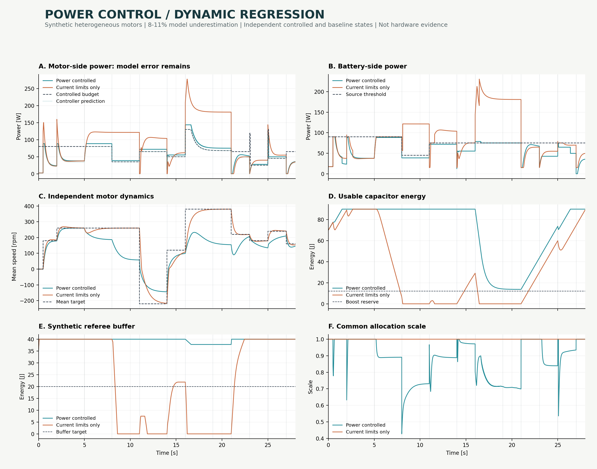

# 动态仿真结果

本结果来自合成参数和独立动态电机模型，不是实车采集、比赛结果或硬件认证。

输入 CSV：`artifacts/simulation/trace.csv`。两条轨迹均运行 28.000 秒。

| 指标 | 限功率控制 | 仅限流基线 |
| --- | ---: | ---: |
| 速度跟踪 RMSE / rpm | 117.011 | 57.690 |
| 实际电机侧功率峰值 / W | 143.587 | 277.700 |
| 功率模型 RMSE / W | 6.061 | 10.331 |
| 功率模型最大绝对误差 / W | 13.587 | 26.140 |
| 电机侧消耗能量 / J | 1617.719 | 2560.858 |
| 电池侧消耗能量 / J | 1637.719 | 2580.325 |
| 实际电机功率高于各自预算的最大值 / W | 13.587 | 224.685 |
| 实际电机功率高于各自预算的积分 / J | 124.303 | 1385.248 |
| 电池侧功率高于供电阈值的最大值 / W | 3.587 | 155.528 |
| 电池侧超阈值积分 / J | 2.233 | 846.589 |
| 最小电容可用能量 / J | 13.738 | 0.000 |
| 最小缓冲能量 / J | 35.000 | 0.000 |
| 功率限幅时间占比 / % | 69.907 | 0.000 |
| 模型不可行采样数 | 0.000 | 0.000 |

## 结果解读

控制器模型故意比物理 plant 低估约 8% 至 11%。因此模型内满足预算，不代表实际电机侧功率严格低于预算；表格保留真实超调，不将其掩盖或作为自动通过指标。

基线仅保留各电机电流限制，使用独立电机、电容和缓冲状态。其日志中的预算是同一预算策略对基线自身状态计算出的参考值，基线不执行这个功率约束。

电机侧预算与电池侧阈值不同；BOOST 可以使用电容供能。判断供电边界应同时看电池侧功率和能量变化。缓冲能量按假设饱和截断，零缓冲本身不会终止仿真。

限功率后的速度误差可能增加，这是功率约束的控制代价。两条轨迹负载相同，但实际转速不同，因此消耗的机械能也不同，不能直接把总能量差叫作效率提升。

控制轨迹覆盖预算 flags：`0x780`；基线覆盖：`0x780`。flags 的定义见 public header。

## 工况

| 开始 / s | 场景 |
| ---: | --- |
| 0.000 | `startup` |
| 2.000 | `cruise` |
| 5.000 | `load_step` |
| 8.000 | `judge_step` |
| 11.000 | `reverse` |
| 14.000 | `charge` |
| 16.000 | `boost` |
| 19.000 | `cap_reserve` |
| 21.000 | `cap_stale` |
| 23.000 | `referee_stale` |
| 25.000 | `buffer_stale` |
| 27.000 | `recovery` |

矢量图：[power_control_sim.svg](assets/power_control_sim.svg)。完整模型、时间步长、供电边界与回归断言见 [仿真说明](../simulations/README.md)。
